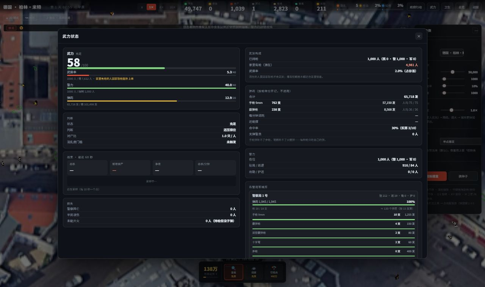
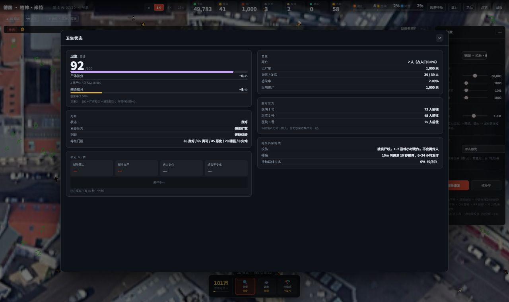
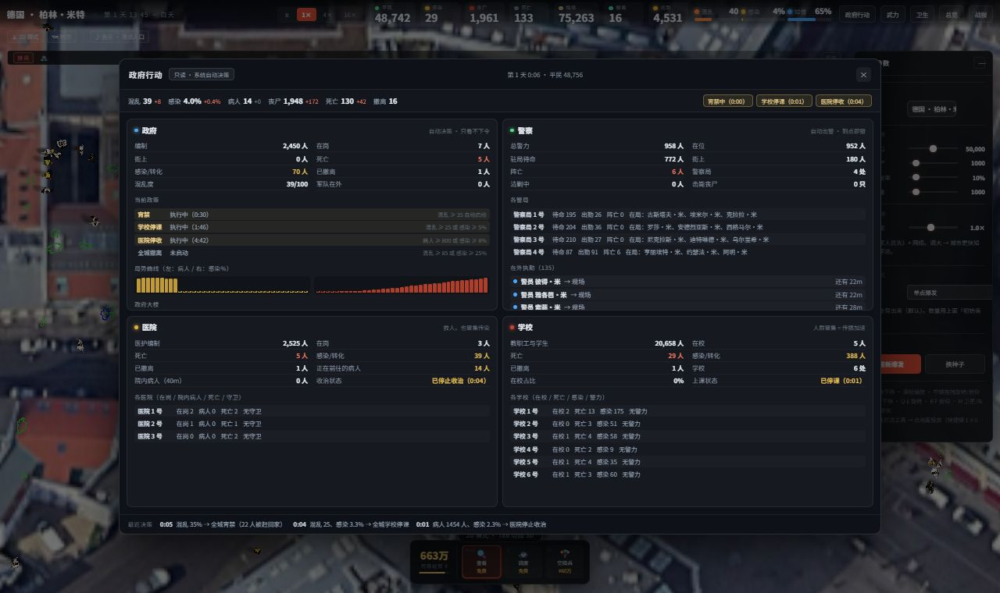
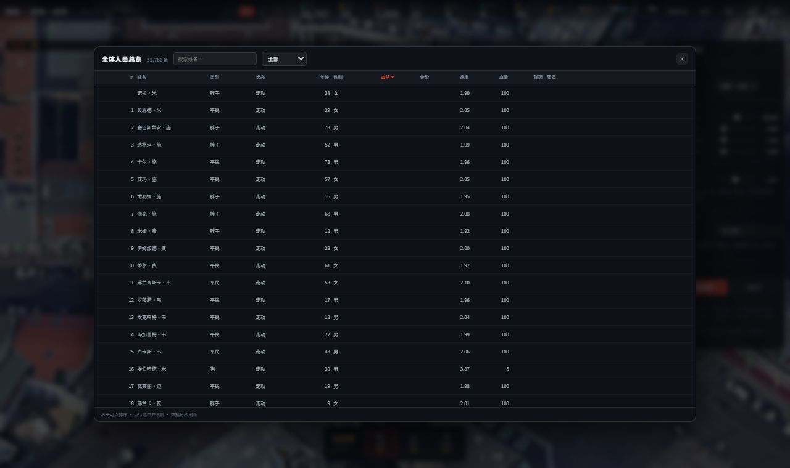
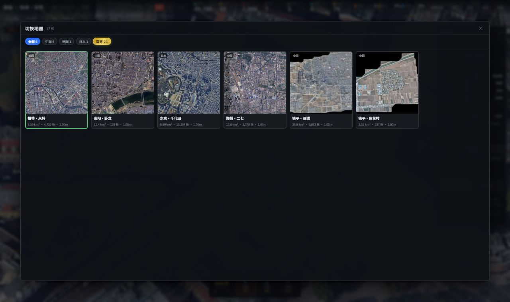

# 生化危机模拟器

### Resident Evil Simulator

> 一个跑在浏览器里的**大规模丧尸爆发模拟器**：把整座城市的人、警察、军队、丧尸放进同一个
> 20 Hz 的模拟里，几万个体各自决定去哪、跟谁走、什么时候逃、什么时候开火。
> 用卫星影像当底图，按真实街道的碰撞几何行走 —— 但**不是**策略游戏，你只能"发动"一场爆发，
> 然后看着它自己演化。


> **一张正在运行的地图**：柏林·米特，49,000 平民在街区里通勤，63 感染、133 死亡，
> 混乱度 40（顶部实时读数）。点开任意一个人就有档案卡，画面上那些小点就是每一个个体。

---

## 献给Binary Space，他们有天才的想法和卓越的工作

小时候，我在iPhone 4上第一次玩到了它。这类游戏在手机上并不常见，唯一接近的是瘟疫公司。但它并不像瘟疫公司那么成功，在生化危机电影大火的年代里，它就像一个粉丝的设定集。
可惜的是，后来它没有再更新。在iPhone系统更新换代之后，它也就不能再运行了。毫无疑问，非常遗憾。

### 所以，先说清楚一件事

> **本作品严格来说不是"基于原版制作"的。**
> 它没有使用原版的任何一行代码，也不是对原版程序的移植或反编译复刻。
>
> 但它的**全部设计思路与灵感来源，都来自原版**：最基本的行走与感知逻辑、
> 感染扩散的规则、以及**21 张原作地图**
> 与部分贴图素材。

---

## 原作的来历

那款游戏是 2009 年的 Flash 作品 **Zombie Outbreak Simulator**，以及它的续作
**Class 3 Outbreak**（2010）：

- 开发：**[Binary Space](https://www.binaryspacegames.com/about/)** —— 澳大利亚珀斯的独立游戏工作室，2009 年 2 月成立
- **Saxon Druce** —— 技术总监 / 程序
- **Jay Weston** —— 创意总监 / 美术与玩法设计
- 两人此前在 **Ratbag Games** 合作过《Powerslide》(1998)、《Dirt Track Racing》(1999)
- ZOS 原版：把 Google 地图上的**华盛顿特区**变成丧尸沙盒，可调丧尸速度、感染率、平民数量、
  射击精度，最多 1.5 万人被几百上千只丧尸追咬
- C3O 原版：同一张地图上的即时战略版，指挥警察守住 1 km²，在**华盛顿特区**与**英国莱斯特**两张图里拖延疫情
- 2012 年 12 月 Jay 离开后，Saxon 继续做到 2016；2014 年的 **Android 版**由 Saxon 与
  James Filippone、Tim Mutton 合作发布

**没有他们做的那个 Flash 小游戏，就没有这个项目。** 本项目是对它的研究与重制，
所有原始美术、音效、地图瓦片的著作权归 Binary Space 所有。

- 官网：<https://www.binaryspacegames.com/>
- 作者访谈（2017）：[Land of Hope and Gory — Saxon Druce](https://gamecloud.net.au/features/interviews/pgf2017-land-of-hope-and-gory)
- C3O 回顾演讲：[Binary Space 博客](https://www.binaryspacegames.com/page/10/)

### 🔧 ZOS-3DS（社区反编译）

原版手游是 **Cocos2d-x + C++ 的原生 APK**，没有开源。我们能读到它的"规则原文"，
靠的是社区的 3DS 移植项目 **ZOS-3DS** —— 它对 APK 做了一次完整反编译并移植到任天堂 3DS：

- 发布贴：[Zombie Outbreak Simulator for the Nintendo 3DS (ZOS-3DS) is here!](https://gbatemp.net/threads/zombie-outbreak-simulator-for-the-nintendo-3ds-zos-3ds-is-here.685335/)

本项目从它身上读到的关键数据（**没有复制它的代码**）：

| 数据 | 用途 |
|---|---|
| `MapConfigFactory` 的 20 条地图配置 | 15 张 Google 地图的精确经纬度、5 张内嵌图的尺寸 |
| 碰撞值语义（0/3/7/15/22/31/66/35） | 与 2009 版 `355_*.bin` 完全一致 |
| 队伍 / 物种 / 武器参数表 | 校准我们的数值 |

### 🛰️ 地图与影像

- 自建城市：**OpenStreetMap** 数据（ODbL）\+ 公开瓦片
- 原版 15 张 Google 地图的影像：**Esri World Imagery**（原版当年是运行时从 Google 拉的，我们换了公开源）
- 原版莱斯特与 5 张内嵌图：从原版 SWF / APK 内提取的买断影像

---

## 它在模拟什么 —— 我们真正花力气的地方

不是"你打丧尸"，而是**一座城市如何在十几个小时里一步步垮掉**。
下面这些系统互相咬合，任何一项调到极端，结局都会完全不同。

### 🧑‍🤝‍🧑 个体：每个人都有一张"人设"

每个居民都有独立的**姓名、年龄、性别、家庭、住址、工作地、职业**，以及**四维性格**：

| 性格维度 | 影响 |
|---|---|
| **政府信任** | 高的人听到广播会配合撤离；低的人第一反应是"官方在骗人"，自己跑 |
| **家庭责任** | 决定他会不会为了找家人**逆着人流往回走** |
| **意志** | 抵抗恐慌的能力，低的人一有风吹草动就崩 |
| **勇猛** | 敢不敢留下来持枪硬顶 |

性格不是纯随机：职业与年龄会先定一个基准，再加个人噪声 —— **警察不会普遍不信任政府**，
退休老人不会普遍莽撞。所以把人点开，你会觉得"这个人挺合理"。

在此基础上派生出：

- **通勤**：早出晚归，家与单位是两个真实坐标，通勤路线要绕开墙
- **感知**：平民 40 m / 警察 50 m / 丧尸 60 m / 军队 80 m —— **看不见就不会跑**
- **两类逃跑**：50 m 内的**瞬间四散**；更远的会**有目标地撤**（回家 / 去警局 / 出城），
  而且目标会随局势变化（家没了就改去警局）
- **家庭纽带**：一家人同姓、住一起；父母会回头找孩子，孩子跟着大人跑，一家人的死活是连锁的
- **身份差异**：警察、士兵、重装兵、装甲车组、要员、游客、流浪狗、家猫、家养宠物 —— 各有各的规则

### 🦠 感染链：这是整个模拟的发动机

- **咬合 → 潜伏 → 尸变**：被咬后进入 60–120 秒潜伏期，这段时间他会**被当成病人送医**，
  也可能在街上突然倒下；潜伏期的人还会继续走动、继续传染
- **接触传播**：潜伏期与正常人长时间接触也会被感染（360–1440 秒），所以"人挤人的避难所"很危险
- **特殊感染体**：不同变种有不同的血量、伤害、速度，普通丧尸伤害恒为 20 —— 只有特殊体例外
- **死亡不等于结束**：尸体有概率**重新爬起来**
- **尸变会传染恐慌**：附近的人看见同类倒下，知情值会跳

### 📣 信息与混乱度：城市的"神经系统"

这是最复杂、也最像真实灾难的一块：

- **知情值**：谁知道了、知道到什么程度，直接决定他逃不逃
- **信息传播**：**电话（家人优先）+ 网络**两条通道，速度可调
  —— 调快就是"全城更早知道、更早逃"，调慢就是"人都死了隔壁还在买菜"
- **混乱度**（0–100）= 知情值 × 0.5 + 感染值 × 2，每一条都推着城市往三个方向走：
  **抢购囤积 → 社会秩序松动 → 大规模逃亡**
- 混乱度会触发**阶段事件**：超市被抢空、加油站排队、银行挤兑、学校停课、医院停诊、
  宵禁、军队进驻、清剿行动、全城撤离令
- 混乱度越高，**要员护送的出动门槛越低**（20 就派四人小队送警局，80 才派八人小队出城）

### 🚓 武力：警察不是无限刷出来的

- 警察**驻在警局里**，出警是**把局里的人派出去**，警力是真实消耗品
- 每座城市的**警察局军械库**独立配置：手枪、霰弹枪、步枪按面积与等级发放，
  打光了就得回去补
- **射击精度严格区分**：平民 10% / 警察 30% / 军队 80%
- **家庭持枪率**可调，决定平民是"待宰"还是"能还手"；家里有枪的人会**回家取枪**
- 军队是独立系统：进驻、巡逻、清剿，火力强但反应慢，误伤与惊扰会进一步推高混乱



> **武力**：城市里还剩多少把枪、多少发子弹、多少在岗警力，谁在开火、命中率如何 ——
> 一局打下来，弹药是会真的见底的。

### 🏥 卫生与医疗：撑不住的第二个战场

- 医院收治潜伏期病人 —— 但**床位与警力是有限的**，收得越多，被咬穿的风险越大
- **医院停诊**后，病人只能回家，感染者由此回到社区
- 尸体不及时处理会**堆在医院与街道**，进一步推动恐慌与感染
- 停课会让孩子集中在家（家庭内部传染 ↑），但也会减少学校聚集（校园爆发 ↓）
  —— 每个决策都是**双向的**



> **卫生**：医院的收治能力（床位数）、停尸压力、垃圾与水质、干净水源覆盖、
> 以及"停收"之后病人回流到社区的速度。城市不是直接被丧尸打垮的，是先被卫生系统拖垮的。

### 🏛️ 政府行动：四类设施，一条决策链

政府面板把城市拆成 **政府 / 警察 / 医院 / 学校** 四类设施，实时显示每处的
**在校（在岗）人数、死亡、感染、警力**，并按混乱度与感染率触发决策：

停课 → 停诊 → 宵禁 → 军队进驻 → 清剿 → 撤离令

每一步都会写进"最近决策"日志，也会立刻改变街上的行为 ——
**停课之后，你会看到成群的学生往家跑**。



> **政府行动**（只读仪表盘）：左上角是城市总账（混乱 39、感染 4.0%、死亡 1,948），
> 四张卡片分别是政府 / 警察 / 医院 / 学校 —— 每张都列出在岗人数、死亡、感染分化、
> 以及"当前决策"为什么还没触发（例如"混乱 ≥ 35 袭击商店"）。右下角是最近决策日志：
> 「混乱 35% → 全城宵禁（22 人挤回家）」「感染 1.3% → 医院停止收治」。

### 📊 总览、档案与结算

- **总览表**：几万人可搜索、可排序、可筛（平民/警察/丧尸/感染/死亡/要员），点一行就跟随镜头
- **档案卡**：姓名、年龄、职业、家庭关系（配偶/子女/父母/宠物）、当前目标、可见的连线
- **结算报告**：人口曲线、感染曲线、死亡分布、要员结局、评分 —— 一局打完知道自己"输得多惨"



> **总览**：几万人一张表，可按平民 / 警察 / 丧尸 / 感染 / 死亡 / 要员筛选，
> 可搜索姓名、按任意列排序，点一行镜头就飞过去跟着他。

### 📰 快讯：只播真实发生的事

跑马灯不是随机文案，每条都由**实际局势**触发；同一起事件还有**多种说法**（随机挑一条），
所以每局看到的报纸口吻都不一样。**零号病人模式**有一整套独立文案：
前期完全不提"丧尸"，只有失联、发热门诊、不明原因死亡 —— 直到第一起咬人事件。

### 🧱 还有这些细节

- **墙会被撞塌**：同一格墙被撞 10 次就塌，之后能穿过去（不是穿墙，是真塌）
- **门是可走的、窗不可走但通视线**，室内外是两套寻路
- **地形图层**（`C`）：每一格的墙/门/窗/水/林地可视化，用来检查碰撞层对不对
- **图层编辑器**（历史功能）：手绘修正碰撞层，改动存在本地

---

## 地图

**27 张**，全部自带碰撞几何与卫星/航拍底图：

| 来源 | 张数 | 说明 |
|---|---|---|
| **原版官方地图** | **21** | 从原版 SWF 与手游 APK 中提取：买断影像 + 内嵌碰撞层 + 精确坐标 |
| **自建城市** | **6** | 用 OSM 数据烘焙，覆盖亚洲、欧洲、北美不同尺度 |



每张图按**自己的原始网格**走：自建城市统一 1 m/格；从原版导入的按其资源算
（例如那张 4608 px ÷ 1152 格 × 0.11 m = **0.44 m/格** 的图）。


> 地形图层：红=墙/栅栏，蓝=水，青=窗，绿=门，橙=室内，深绿=林地。

---

## 快速开始

**唯一要求：Python 3**（只用来起一个本地静态服务器，游戏本身是纯前端）。

### Windows

双击根目录的 **`生化危机模拟器.bat`** —— 它会自动重启服务、开浏览器、带上防缓存参数。

### macOS / Linux

```bash
python3 工具/serve.py 8777
# 打开 http://127.0.0.1:8777/
```

> ⚠️ **不要用 `python -m http.server`**：它不返回 `Cache-Control`，浏览器会缓存 ES 模块，
> 改了代码却还在跑旧的。`工具/serve.py` 专门对 html/js/css/json 发 `no-store`。

---

## 操作

| 键 | 作用 |
|---|---|
| 右键拖拽 / WASD | 平移 |
| 滚轮 | 缩放 |
| 中键拖拽 / Q E / R F | 旋转 / 俯仰 |
| `Tab` | 2D 像素模式 ↔ 3D |
| `C` | 地形图层 |
| `M` / `B` | 卫星↔矢量 / 3D 建筑显隐 |
| `O` | 总览表（可搜索、可排序） |
| `1`–`9` `0` `-` `=` | 选指挥工具 → 点地面投放 |
| 点击人物 | 打开档案卡（姓名/年龄/职业/家庭/疫情状态/连线） |

---

## 技术要点

| 项 | 实现 |
|---|---|
| 模拟规模 | 单地图上限 62,000 个体，20 Hz 固定步长（`DT = 1/20`） |
| 数据布局 | 全部 SoA（Struct of Arrays），`Uint8Array` / `Float32Array` 平铺，无对象分配 |
| 寻路 | 碰撞位网格 + 门场 BFS + 视线查询，`WALK/SIGHT/INDOOR` 位掩码 |
| 确定性 | mulberry32 种子随机，同种子同开局必定同样结局（有测试） |
| 渲染 | three.js；3D 点云 + 2D 图集精灵（四层实例化）。另有一个简单的 2D 像素视角可切（Tab），算是致敬原版，做得比较随意 |
| 音效 | 全程序化合成，无音频文件；事件驱动，100 m 范围，室内过滤高频 |
| 音乐 | 5 首原创曲目，随机循环，可在第二栏切换 |
| 大地图优化 | 远处个体降频（`dt × 4`），所有冷却计时统一走 `cdt` |

---

## 目录

```
index.html            入口
js/                   模拟与渲染（sim.js 是核心）
  sim.js              世界状态 + 每帧推进（SoA）
  people.js           个体档案（纯函数，同一个人处处一致）
  profiles.js         姓名/职业/街道/单位池（按国家切换）
  citymeta.js         城市命名唯一来源
  collision.js        碰撞层解码 + 门场
  city.js             城市几何 + 卫星地面
  agents.js           3D 点云
  src/sprite/         2D 像素渲染
  gov.js / status.js  政府行动 / 武力卫生面板
  overview.js         全体总览
  report.js           结算报告
  news.js             快讯跑马灯
  music.js            背景音乐
css/                  样式（整体随窗口缩放）
数据库/cities/        27 张地图：city.json + sat.jpg + thumb.jpg
assets/               精灵图集 + 背景音乐
工具/                 本地服务器 + 两个测试
vendor/               three.js
```

## 测试

```bash
node 工具/test_chain.mjs   # 主链路：尸变链、爬起、行为 5 项
node 工具/test_sim.mjs     # 性能 + 确定性（同种子必须同哈希）
```

---

## 许可与声明

- **代码**：本仓库代码可自由阅读、学习、修改。
- **原作素材**（`数据库/cities/leicester`、5 张内嵌图的影像与碰撞表、
  以及项目历史中出现过的原版美术/音效）著作权归 **Binary Space** 所有，
  仅作研究与学习用途，**不得商用**。
- **地图数据**：自建城市来自 OpenStreetMap（© OpenStreetMap contributors, ODbL）；
  15 张原版地图的底图为 Esri World Imagery，仅供个人研究使用。
- **背景音乐**：本项目自制。

> 这是一个粉丝性质的重制/研究项目，与 Binary Space 无隶属关系。
> 如果你喜欢这套玩法，请去玩一次原版 —— 它只有几百 KB，但你会看到我们所有设计的源头。
