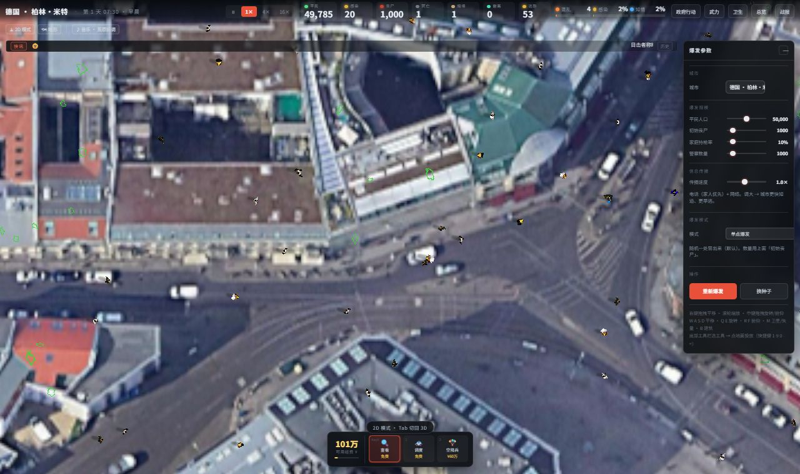
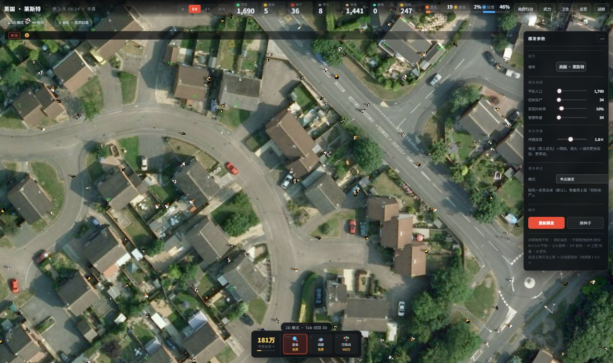
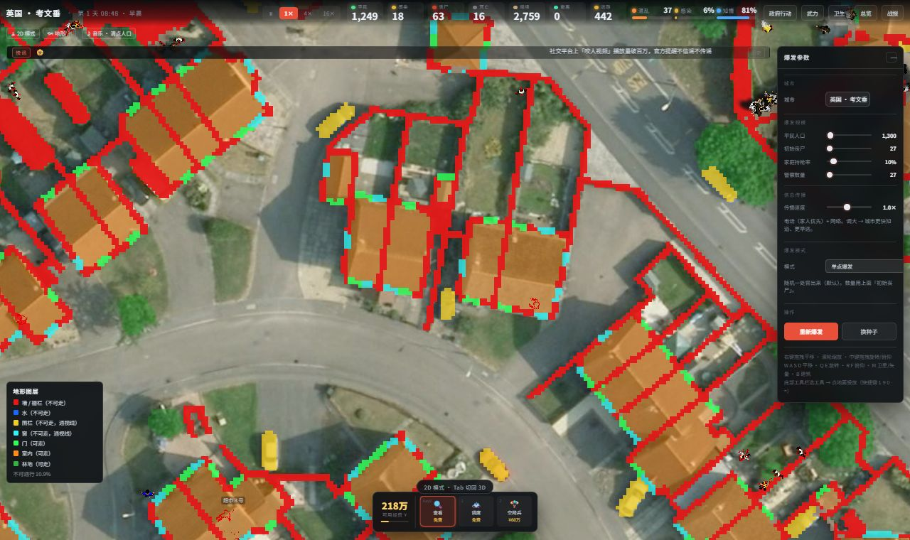

# 生化危机模拟器 · ZOS-R

> 一个跑在浏览器里的**大规模丧尸爆发模拟器**：把整座城市的人、警察、军队、丧尸放进同一个
> 20 Hz 的模拟里，几万个体各自决定去哪、跟谁走、什么时候逃、什么时候开火。
> 用卫星影像当底图，按真实街道的碰撞几何行走 —— 但**不是**策略游戏，你只能"发动"一场爆发，
> 然后看着它自己演化。



---

## 致谢 · 关于原作

这个项目的**世界、规则和"味道"来自一款 2009 年的 Flash 游戏**：

### 🧟 Zombie Outbreak Simulator（2009）/ Class 3 Outbreak（2010）

- 开发：**[Binary Space](https://www.binaryspacegames.com/about/)** —— 澳大利亚珀斯的独立游戏工作室，2009 年 2 月成立
- **Saxon Druce** —— 技术总监 / 程序
- **Jay Weston** —— 创意总监 / 美术与玩法设计
- 两人此前在 **Ratbag Games** 合作过《Powerslide》(1998)、《Dirt Track Racing》(1999)
- ZOS 原版：把 Google 地图上的**华盛顿特区**变成丧尸沙盒，可调丧尸速度、感染率、平民数量、
  射击精度，最多 1.5 万人被几百上千只丧尸追咬
- C3O 原版：同一张地图上的即时战略版，指挥警察守住 1 km²，在**华盛顿特区**与**英国莱斯特**两张图里拖延疫情
- 2012 年 12 月 Jay 离开后，Saxon 继续做到 2016；2014 年的 **Android 版**由 Saxon 与
  James Filippone、Tim Mutton 合作发布

**没有他们做的那个 Flash 小游戏，就没有这个项目。** 本项目是对它的研究与重制，
所有原始美术、音效、地图瓦片的著作权归 Binary Space 所有。

- 官网：<https://www.binaryspacegames.com/>
- 作者访谈（2017）：[Land of Hope and Gory — Saxon Druce](https://gamecloud.net.au/features/interviews/pgf2017-land-of-hope-and-gory)
- C3O 回顾演讲：[Binary Space 博客](https://www.binaryspacegames.com/page/10/)

### 🔧 ZOS-3DS（社区反编译）

原版手游是 **Cocos2d-x + C++ 的原生 APK**，没有开源。我们能读到它的"规则原文"，
靠的是社区的 3DS 移植项目 **ZOS-3DS** —— 它对 APK 做了一次完整反编译并移植到任天堂 3DS：

- 发布贴：[Zombie Outbreak Simulator for the Nintendo 3DS (ZOS-3DS) is here!](https://gbatemp.net/threads/zombie-outbreak-simulator-for-the-nintendo-3ds-zos-3ds-is-here.685335/)

本项目从它身上读到的关键数据（**没有复制它的代码**）：

| 数据 | 用途 |
|---|---|
| `MapConfigFactory` 的 20 条地图配置 | 15 张 Google 地图的精确经纬度、5 张内嵌图的尺寸 |
| 碰撞值语义（0/3/7/15/22/31/66/35） | 与 2009 版 `355_*.bin` 完全一致 |
| 队伍 / 物种 / 武器参数表 | 校准我们的数值 |

### 🛰️ 地图与影像

- 自建城市：**OpenStreetMap** 数据（ODbL）\+ 公开瓦片
- 原版 15 张 Google 地图的影像：**Esri World Imagery**（原版当年是运行时从 Google 拉的，我们换了公开源）
- 原版莱斯特与 5 张内嵌图：从原版 SWF / APK 内提取的买断影像

---

## 它到底在模拟什么

不是"你打丧尸"，而是**一座城市在 12 小时里怎么一步步垮掉**。



### 个体层面

每个居民都有独立的**姓名、年龄、性别、家庭、职业、住址、工作地、性格**（政府信任 / 家庭责任 /
意志 / 勇猛），并且：

- **通勤**：早上出门上班、晚上回家，突发事件时"回家"成为第一优先级
- **感知**：平民 40 m、警察 50 m、军队 80 m；看见丧尸才跑，没看见就继续走
- **逃跑分两类**：50 m 内**立即四散**；更远的会**有目标地撤**（回家 / 去警局 / 出城）
- **家庭**：一家人同姓、住一起；父母会回头找孩子，孩子会跟着大人跑
- **感染链**：被咬 → 潜伏期（60–120 秒）→ 尸变；潜伏期的人会被当成病人送医，也可能突然倒下
- **要员**：护送小队从政府大楼把人送到警察局，混乱度破 80 才安排出城

### 群体层面

- **混乱度**（0–100）：由知情值 × 0.5 + 感染值 × 2 推动，决定抢购、宵禁、停课、撤离令的触发
- **信息传播**：电话（家人优先）\+ 网络；传播速度可调，调大就是"全城更早知道、更早逃"
- **政府决策**：停课、停诊、宵禁、军队进驻、清剿、撤离令；每个决策都会继续推高或压低混乱
- **警察与军队**：警力有限，出警 = 把人从警局派出去，不会凭空刷出人；射击精度平民 10% / 警察 30% / 军队 80%
- **墙会被撞塌**：同一格墙被丧尸撞 10 次就塌，之后可以穿过去

---

## 地图

**27 张**，全部自带碰撞几何与卫星/航拍底图：

| 来源 | 数量 | 说明 |
|---|---|---|
| **原版官方** | 21 | 莱斯特（2009 SWF）+ 5 张手游内嵌影像 + 15 张手游 Google 地图 |
| **自建** | 6 | 柏林·米特 · 南阳·卧龙 · 东京·千代田 · 郑州·二七 · 镇平·县城 · 镇平·唐营村 |


每张图按**自己的原始网格**走：自建城市统一 1 m/格，从原版导入的按其资源算
（例如莱斯特是 4608 px ÷ 1152 格 × 0.11 m = **0.44 m/格**）。



> 地形图层：红=墙/栅栏，蓝=水，青=窗，绿=门，橙=室内，深绿=林地。用来检查碰撞层对不对。

---

## 快速开始

**唯一要求：Python 3**（只用来起一个本地静态服务器，游戏本身是纯前端）。

### Windows

双击根目录的 **`生化危机模拟器.bat`** —— 它会自动重启服务、开浏览器、带上防缓存参数。

### macOS / Linux

```bash
python3 工具/serve.py 8777
# 打开 http://127.0.0.1:8777/
```

> ⚠️ **不要用 `python -m http.server`**：它不返回 `Cache-Control`，浏览器会缓存 ES 模块，
> 改了代码却还在跑旧的。`工具/serve.py` 专门对 html/js/css/json 发 `no-store`。

---

## 操作

| 键 | 作用 |
|---|---|
| 右键拖拽 / WASD | 平移 |
| 滚轮 | 缩放 |
| 中键拖拽 / Q E / R F | 旋转 / 俯仰 |
| `Tab` | 2D 像素模式 ↔ 3D |
| `C` | 地形图层 |
| `M` / `B` | 卫星↔矢量 / 3D 建筑显隐 |
| `O` | 总览表（可搜索、可排序） |
| `1`–`9` `0` `-` `=` | 选指挥工具 → 点地面投放 |
| 点击人物 | 打开档案卡（姓名/年龄/职业/家庭/疫情状态/连线） |

---

## 技术要点

| 项 | 实现 |
|---|---|
| 模拟规模 | 单地图上限 62,000 个体，20 Hz 固定步长（`DT = 1/20`） |
| 数据布局 | 全部 SoA（Struct of Arrays），`Uint8Array` / `Float32Array` 平铺，无对象分配 |
| 寻路 | 碰撞位网格 + 门场 BFS + 视线查询，`WALK/SIGHT/INDOOR` 位掩码 |
| 确定性 | mulberry32 种子随机，同种子同开局必定同样结局（有测试） |
| 渲染 | three.js；3D 点云 + 2D 图集精灵（四层实例化：活体/尸体/阴影/圆点） |
| 音效 | 全程序化合成，无音频文件；事件驱动，100 m 范围，室内过滤高频 |
| 音乐 | 5 首原创曲目，随机循环，可在第二栏切换 |
| 大地图优化 | 远处个体降频（`dt × 4`），所有冷却计时统一走 `cdt` |

---

## 目录

```
index.html            入口
js/                   模拟与渲染（sim.js 是核心）
  sim.js              世界状态 + 每帧推进（SoA）
  people.js           个体档案（纯函数，同一个人处处一致）
  profiles.js         姓名/职业/街道/单位池（按国家切换）
  citymeta.js         城市命名唯一来源
  collision.js        碰撞层解码 + 门场
  city.js             城市几何 + 卫星地面
  agents.js           3D 点云
  src/sprite/         2D 像素渲染
  gov.js / status.js  政府行动 / 武力卫生面板
  overview.js         全体总览
  report.js           结算报告
  news.js             快讯跑马灯
  music.js            背景音乐
css/                  样式（整体随窗口缩放）
数据库/cities/        27 张地图：city.json + sat.jpg + thumb.jpg
assets/               精灵图集 + 背景音乐
工具/                 本地服务器 + 两个测试
vendor/               three.js
```

## 测试

```bash
node 工具/test_chain.mjs   # 主链路：尸变链、爬起、行为 5 项
node 工具/test_sim.mjs     # 性能 + 确定性（同种子必须同哈希）
```

---

## 许可与声明

- **代码**：本仓库代码可自由阅读、学习、修改。
- **原作素材**（`数据库/cities/leicester`、5 张内嵌图的影像与碰撞表、
  以及项目历史中出现过的原版美术/音效）著作权归 **Binary Space** 所有，
  仅作研究与学习用途，**不得商用**。
- **地图数据**：自建城市来自 OpenStreetMap（© OpenStreetMap contributors, ODbL）；
  15 张原版地图的底图为 Esri World Imagery，仅供个人研究使用。
- **背景音乐**：本项目自制。

> 这是一个粉丝性质的重制/研究项目，与 Binary Space 无隶属关系。
> 如果你喜欢这套玩法，请去玩一次原版 —— 它只有几百 KB，但你会看到我们所有设计的源头。
